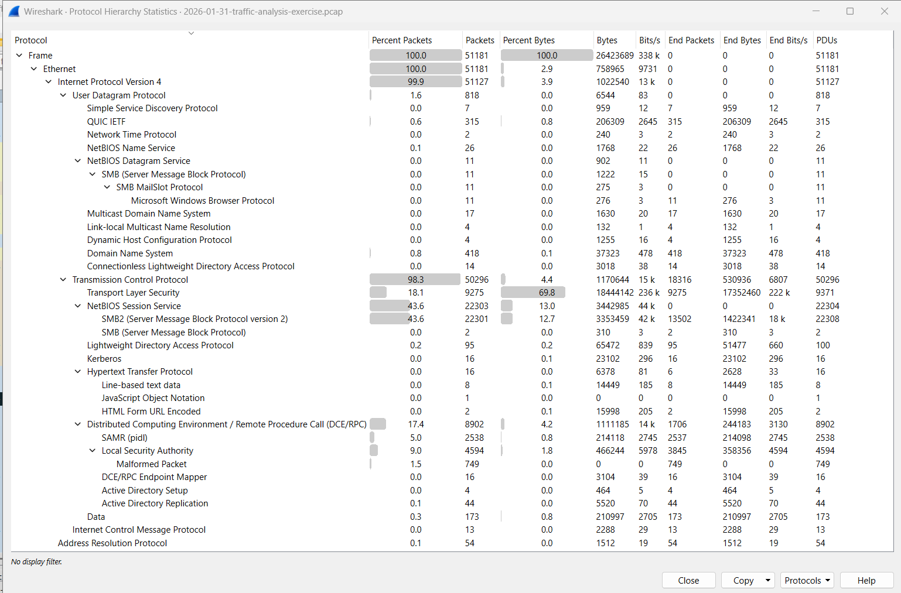
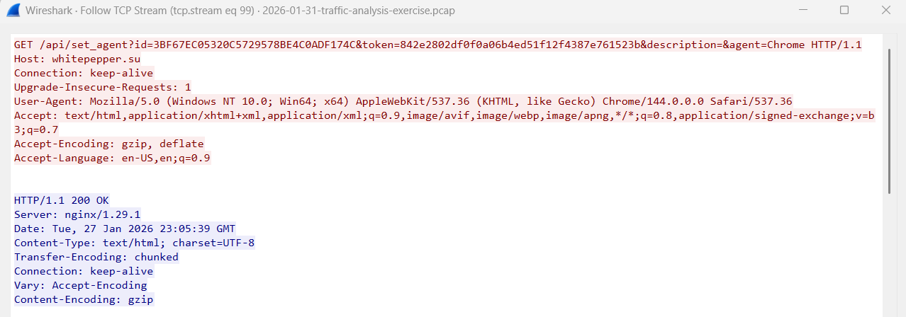
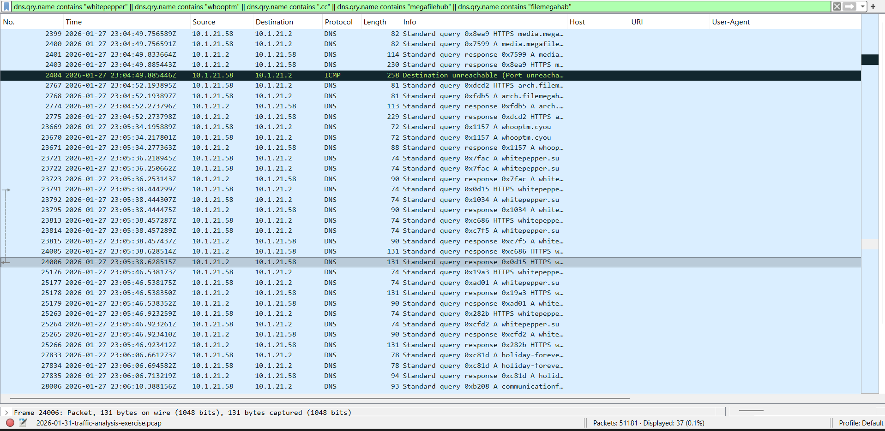
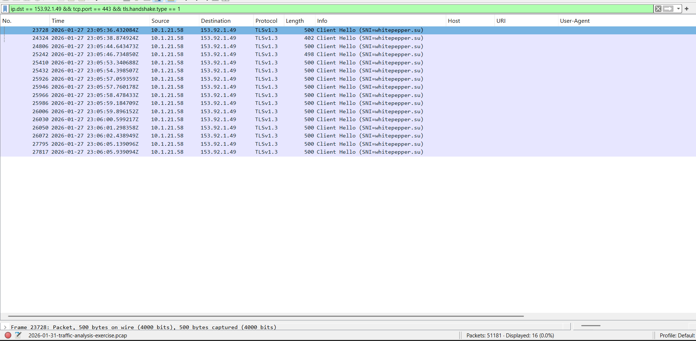
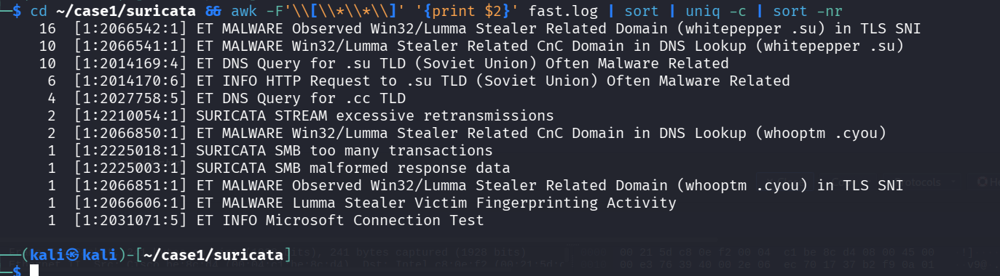
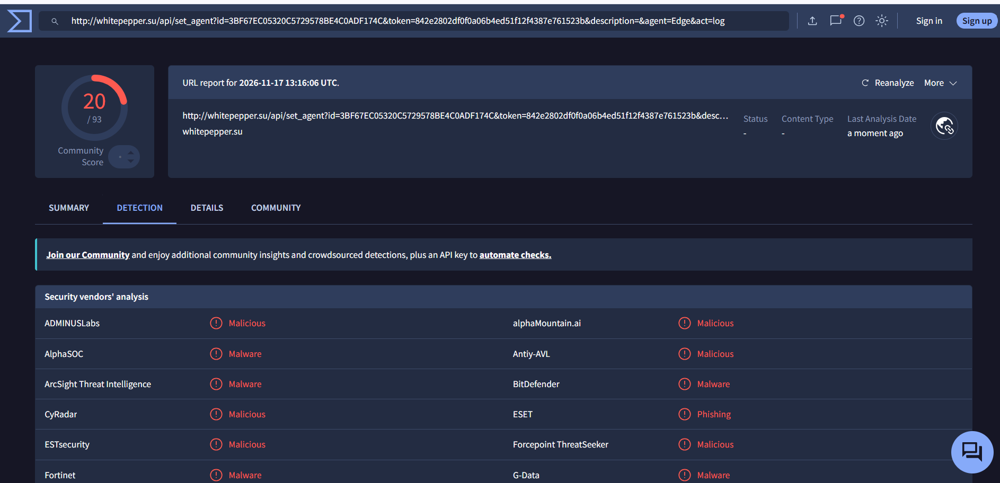

## 1. Protocol Analysis Overview

A comprehensive network traffic investigation was performed on `2026-01-31-traffic-analysis-exercise.pcap` using **Wireshark**, **Zeek**, and **Suricata**.

The capture contains **51,181 packets** totaling **26,423,689 bytes**. The traffic is predominantly composed of:

- **TCP:** 98.3% (50,296 packets)
- **UDP:** 1.6% (818 packets)

At the application layer, the primary protocols identified include:

| Protocol | Traffic Percentage / Count |
|---|---:|
| SMB2 | 43.6% |
| TLS | 18.1% |
| DCE/RPC | 17.4% |
| DNS | 418 packets |
| QUIC | 315 packets |
| HTTP | 16 packets |

### Protocol Hierarchy Evidence

---

## 2. Protocol & Anomaly Investigation Findings

### A. HTTP Traffic & TCP Stream Analysis

Analysis of Zeek `http.log` and Wireshark TCP Stream (`tcp.stream eq 99`) identified HTTP traffic over port `80` from `10.1.21.58` to `whitepepper.su` (`153.92.1.49`).

The traffic included `GET` and `POST` requests to `/api/set_agent`, containing a victim ID, session token, and browser information (Chrome and Edge). The server responded with `HTTP/1.1 200 OK`.

**Figure 2. HTTP Communication with the C2 Server**

### B. DNS Analysis & DNS Tunneling Investigation

Zeek `dns.log` showed no evidence of DNS tunneling. The 236 DNS transactions used standard record types, with no `TXT` or `NULL` records. Longer domain names were associated with legitimate Active Directory LDAP SRV queries.

However, several suspicious domains associated with C2 and staging activity were identified.

| Domain | Resolved IP Address(es) | Time (UTC) |
|---|---|---|
| `media.megafilehub4.lat` | `104.21.48.156`, `172.67.154.67` | 23:04:49 |
| `arch.filemegahab4.sbs` | `104.21.46.67`, `172.67.136.13` | 23:04:52 |
| `whooptm.cyou` | `62.72.32.156` | 23:05:34 |
| `whitepepper.su` | `153.92.1.49` | 23:05:36–23:05:46 |
| `holiday-forever.cc` | `80.97.160.24` | 23:06:06 |
| `communicationfirewall-security.cc` | `104.21.9.36`, `172.67.141.109` | 23:06:10 |

### C. TLS Metadata, Beaconing & Large Outbound Transfers

Zeek `ssl.log` and `conn.log` identified 16 TLSv1.3 connections from `10.1.21.58` to `whitepepper.su` (`153.92.1.49:443`), using the `TLS_AES_256_GCM_SHA384` cipher suite. TLS SNI confirmed the destination, while server certificate details were not available in the analyzed X.509 logs.

**Key Findings**

| Finding | Observation |
|---|---|
| High-Frequency Beaconing | Repeated Client Hello messages at approximately 0.70-second intervals (23:05:57–23:06:01 UTC). |
| Outbound Data Transfer | Three TLS sessions transferred 2,060,468 bytes (~2.06 MB) outbound. |
| Server Response | Approximately 2,245 bytes received per session. |
| Unexpected Destinations | Additional connections to `whooptm.cyou`, `holiday-forever.cc`, `communicationfirewall-security.cc`, and `media.megafilehub4.lat`. |

**Outbound Transfer Breakdown**

| Session | Outbound Bytes |
|---|---:|
| 1 | 1,419,610 |
| 2 | 387,597 |
| 3 | 253,261 |
| **Total** | **2,060,468** |

### D. SMB Activity & Unusual Ports Check

**SMB Activity**

Zeek `smb_mapping.log` and `smb_files.log` identified SMB communication between workstation `10.1.21.58` and the internal Domain Controller `10.1.21.2` over TCP port `445`.

| Item | Details |
|---|---|
| Source Host | `10.1.21.58` |
| Destination Host | `10.1.21.2` |
| Domain Controller | `WIN-LU4L24X3UB7.win11office.com` |
| Shared Resources | `IPC$`, `Shared` |
| Data Sent | 1,780,078 bytes |
| Data Received | 1,588,769 bytes |
| Observation | No malicious file drops or lateral movement payloads were identified. |

**Unusual Ports Check**

Inspection of Zeek `conn.log` showed no unusual or non-standard ports.

| Observed Ports | Services |
|---|---|
| `53` | DNS |
| `80` | HTTP |
| `88` | Kerberos |
| `135` | MS RPC |
| `389` | LDAP |
| `443` | HTTPS |
| `445` | SMB |
| `5228` | Application Traffic |

## 3. Suricata Alert Review

Suricata generated **55 alerts across 12 unique signatures**. The alerts were reviewed and correlated with Zeek logs and packet captures.

**Figure 5. Suricata Alert Summary**

### Alert Classification

| Count | Signature ID | Alert Name | Classification |
|---:|---|---|---|
| 16 | `2066542` | Lumma Stealer Domain in TLS SNI (`whitepepper.su`) | True Positive |
| 10 | `2066541` | Lumma Stealer C2 Domain in DNS (`whitepepper.su`) | True Positive |
| 10 | `2014169` | DNS Query for `.su` TLD | True Positive |
| 6 | `2014170` | HTTP Request to `.su` TLD | True Positive |
| 4 | `2027758` | DNS Query for `.cc` TLD | True Positive |
| 2 | `2066850` | Lumma Stealer C2 Domain in DNS (`whooptm.cyou`) | True Positive |
| 1 | `2066851` | Lumma Stealer Domain in TLS SNI (`whooptm.cyou`) | True Positive |
| 1 | `2066606` | Lumma Stealer Victim Fingerprinting | True Positive |
| 2 | `2210054` | Excessive TCP Retransmissions | False Positive |
| 1 | `2225018` | SMB Too Many Transactions | False Positive |
| 1 | `2225003` | SMB Malformed Response Data | False Positive |
| 1 | `2031071` | Microsoft Connection Test | False Positive |

### Alert Review Summary

| Classification | Alerts |
|---|---:|
| True Positive | 50 |
| False Positive | 5 |
| **Total** | **55** |

## 4. Threat Intelligence Verification (VirusTotal)

VirusTotal analysis of the extracted C2 URL showed malicious detections by **20 out of 93 security vendors**, including Bitdefender, Fortinet, ESET, and G Data.

---

## 5. Indicators of Compromise (IOC List)
| Indicator Type | Indicator Value | Port / Protocol | Context |
| :--- | :--- | :--- | :--- |
| **Compromised Host** | `10.1.21.58` | Internal | Infected Workstation (`DESKTOP-ES9F3ML`) |
| **Malicious IP** | `153.92.1.49` | `80, 443 / TCP` | Primary Lumma Stealer C2 & Exfiltration (`whitepepper.su`) |
| **Malicious IP** | `62.72.32.156` | `443 / TCP` | Lumma Stealer C2 (`whooptm.cyou`) |
| **Malicious IP** | `80.97.160.24` | `443 / TCP` | Secondary C2 (`holiday-forever.cc`) |
| **Malicious IP** | `104.21.9.36` / `172.67.141.109` | `443 / TCP` | Secondary C2 (`communicationfirewall-security.cc`) |
| **Staging IP** | `104.21.48.156` / `172.67.154.67` | `443 / TCP` | Payload Staging (`media.megafilehub4.lat`) |
| **Staging IP** | `104.21.46.67` / `172.67.136.13` | `443 / TCP` | Payload Staging (`arch.filemegahab4.sbs`) |
| **Malicious Domain** | `whitepepper.su` | `HTTP / HTTPS` | Primary Lumma Stealer C2 |
| **Malicious Domain** | `whooptm.cyou` | `HTTPS` | Secondary Lumma Stealer C2 |
| **Malicious Domain** | `holiday-forever.cc` | `HTTPS` | Secondary C2 |
| **Malicious Domain** | `communicationfirewall-security.cc` | `HTTPS` | Secondary C2 |
| **Staging Domain** | `media.megafilehub4.lat` | `HTTPS` | Initial Staging Infrastructure |
| **Staging Domain** | `arch.filemegahab4.sbs` | `HTTPS` | Initial Staging Infrastructure |
| **Malicious URL** | `http://whitepepper.su/api/set_agent?id=3BF67EC05320C5729578BE4C0ADF174C&token=842e2802df0f0a06b4ed51f12f4387e761523b&description=&agent=Chrome` | `80 / TCP` | Victim Fingerprinting & Chrome Profiling |
| **Malicious URL** | `http://whitepepper.su/api/set_agent?id=3BF67EC05320C5729578BE4C0ADF174C&token=842e2802df0f0a06b4ed51f12f4387e761523b&description=&agent=Edge&act=log` | `80 / TCP` | Victim Fingerprinting & Edge Profiling |

